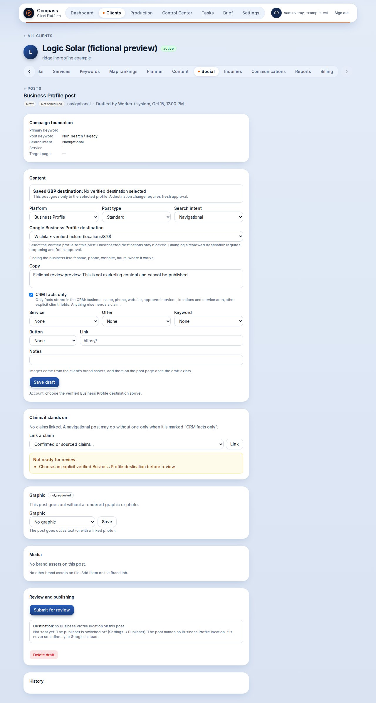
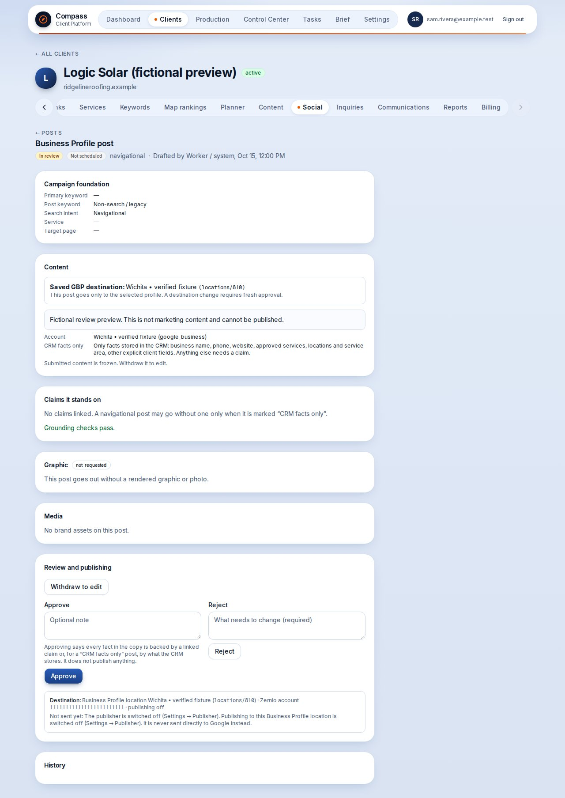
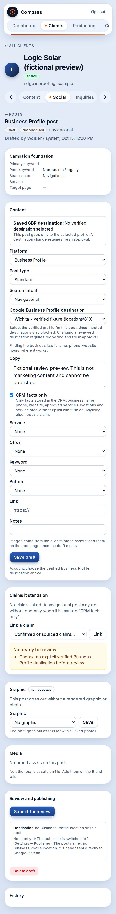
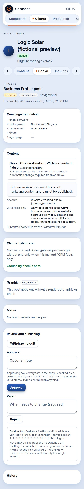

# Explicit Business Profile destinations

Proposed October 15, 2026. Not deployed or applied to production.
Executive OS task: `b8f41035-ddbf-420a-9c04-4433268f1e8b`.
Branch: `codex/logic-explicit-gbp-destinations`, based on main `f5585ea6`.

## Behavior and review contract

- Settings supports several verified GBP profiles per client, including profiles managed through the same connected Google account. A Google location belongs to exactly one Compass client. Facebook's existing binding rules remain.
- Each GBP draft can select a verified destination owned by its client. Logic requires an explicit choice even with only one connected profile. Other single-profile clients retain their default and direct-Google compatibility paths.
- The saved destination is shown during review. The existing approval snapshot/hash includes `social_account_id`. Reviewed content is frozen; reopening clears approval and scheduling, and a destination change requires fresh approval.
- The destination's client, platform and Google location cannot be repurposed, even after unbinding. Publisher requests pin `locationId`; retry generations and same-key retries retain their recorded destination. Missing, foreign, unverified and excluded profiles fail closed. Exclusions apply before sending or retrying existing approvals too.
- Binding verifies the exact location through Zernio and requires its website host to match the client's website. It never enables publishing. A missing/mismatching website must be resolved before a new binding; existing valid bindings are unchanged.
- Logic's policy excludes Austin `locations/2702790686939089446`. No address is returned in the GBP account report or shown in the picker/preflight. Market labels come from the verified location website path, never a street address.
- No content approval, image provenance or claim checks are relaxed. ChatGPT images remain illustrative, never represented as real Logic installations. PR #163 owns the illustrative-image implementation; this branch does not duplicate it.
- Monthly delivery stays client-scoped: eight October GBP posts total across destinations, not eight per profile. This change creates no planner slots and changes no dates or quotas.

## Provider recheck and account action

Read-only Zernio recheck on October 15 at 17:05 UTC:

| Item | Evidence / next action |
| --- | --- |
| Connected Zernio Google account | `6acc06d593b85a1110bf43ba`; healthy, valid token, posting permission. Its display name/default are Lucas, so never use the default as Logic's destination. |
| Underlying Google account | Thomas Dombrowski, `accounts/113991377287975957370`. |
| Wichita | `locations/6226831491529440170`, provider name Logic Solar, website `https://www.logic-solar.com/locations/kansas/wichita`, no address returned. Identity matches Logic. No binding was performed. |
| Overland Park | Absent from the complete accessible location list. The earlier task CID `2667316398874659401` is only a reference to confirm, not a verified connected destination. |
| Austin | Present but explicitly excluded. Never bind or use it for these posts. |

Tom's exact connection action: grant the currently connected Google account manager access to the correct Logic Solar Overland Park profile, accept the access invitation and refresh/reconnect its Google Business Profile connection in Zernio. Alternatively, connect the Google account that already owns/manages that correct profile through Zernio. Then re-list locations and verify the business identity and exact Google location before binding. Keep Logic configured as a service-area business with no public street address or walk-in office.

After release, an admin can bind the verified Wichita location from Settings > Publisher > Logic Solar using the exact Zernio account and location above. Leave publishing off. Recheck live identity at binding time. Overland Park remains blocked until its own profile is connected and verified; never substitute Wichita.

The session restored the previously cleared A/B Overland Park planner holds, conditionally while they had no generated social post. Claude's coordinated session subsequently retained those holds and marked D/G as Overland Park holds. Final readback: eight October `deliverable='gbp'` slots, all eight with no `social_post_id`; A/B/D/G blocked. No copy, dates, counts, bindings, approvals, scheduling or publishing were changed by this implementation session.

## Reviewable UI preview

These are the actual application pages rendered against isolated fictional fixtures. They are not a production connection or marketing content. The draft screenshot shows an unsaved selector choice; the saved destination remains blank until Save. The review screenshot shows a frozen saved destination. Desktop and phone checks exercise both choices, blank explicit default, frozen review, and horizontal overflow.

| Draft selection | Frozen review |
| --- | --- |
|  |  |
|  |  |

Reproduce with Chrome installed:

```sh
GBP_DESTINATION_PREVIEW=1 SCREENSHOTS=docs/screenshots/gbp-destinations npm run design:preview
```

## Validation and release gate

- 122 focused drafter/publisher tests pass, including different destinations on one login, wrong ownership, missing profiles, excluded profiles, pinned retries and legacy clients.
- Embedded PostgreSQL replays all migrations and the real role/JWT review, drafter, Facebook, GBP and explicit-destination SQL suites successfully. Tests cover frozen approval, reopening, cleared approval/schedule, fresh approval, immutable location identity and policy grants/RLS.
- TypeScript, production Next.js build and desktop/phone UI checks pass. Targeted lint has zero errors, with the existing `_prev` warning.
- The broader local suite reported 1,092 passing tests and one existing review test file killed by the runtime memory limit. Running that file separately passed 33 assertions before the last test was killed; that final test passes when isolated. This is not a clean full-suite run.
- Native PostgreSQL binaries are unavailable here and their installation was blocked by container permissions. The existing CI `database` job must pass `scripts/test-portal-sandbox.sh`, which now includes the new destination SQL suite. Full-suite CI remains a merge gate.

Release the migration `20261015170554_explicit_gbp_destinations.sql` before deploying the application, `post-publisher` and `post-drafter`. The new policy reads deliberately fail closed if the publisher runs without the migration. The migration enables nothing and does not bind Logic.

Coordinate integration with #163 (illustrative graphics), #164 (brand review), #165/#166 (claim handoff) and #168 (intent). Shared drafter feature/version markers must be combined, not overwritten; SQL uses narrow function patches to preserve the other changes. Old PR #62 concerns client-level Google OAuth/location setup, not this per-post Zernio contract. Map-grid PRs #167/#169 remain separate.

Do not test approval or publishing against production to validate a preview. A hosted branch preview using the production database will not have the new migration until release; the isolated preview above is the review surface for this PR.
